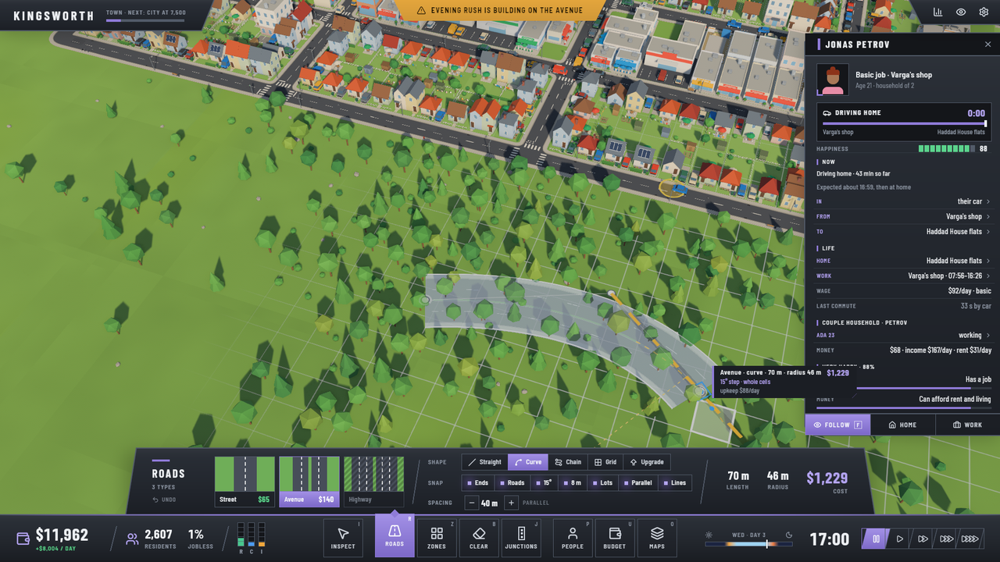

# CitySim

A small, original 3D city-builder written in Rust with [Bevy](https://bevy.org) 0.20. Start on an empty map with a
highway stub, draw roads, paint residential, commercial and industrial zones beside them, and watch a town grow by
demand. Every household has a home and a job and drives to work on the shortest route; streets slow down as they fill,
so a bad road layout shows up as real traffic jams that you fix by rebuilding roads. Taxes, road upkeep and city
services drive the budget.




## Features

- Straight and 45° roads drawn as multi-corner paths that snap to road ends, junctions, T-junctions, extensions,
  perpendicular and parallel alignments and the spacing of the neighbouring block, with live length, price and the
  reason when a road is not possible; streets and avenues (drawing an avenue over a street upgrades it); a block tool
  for whole street grids; undo; bulldozer for rectangles or whole road stretches.
- Residential, commercial and industrial zoning within two cells of a road, by rectangle, along a road's frontage or by
  filling an enclosed block; buildings grow by demand and level up from small houses, shops and sheds to apartment
  blocks and offices.
- Agent traffic: commuters, shopping trips and delivery trucks drive in real time on the right, in lanes (two each way
  on avenues, with lane choice before turns), through junctions with real rules: actuated traffic lights with
  protected left-turn phases on avenues and green waves along them, priority junctions where side roads give way, and
  all-way stops. Junctions pick their control automatically by road type and traffic; the junction tool (J) shows
  each approach's light and queue and switches a junction between automatic, lights and priority. A traffic overlay
  shows each road direction green / amber / red.
- Every building fronts a road: lots are one cell, a deep 1x2 lot with a back garden, or a 2x2 lot, and face their
  street, so a filled block never grows a second row of houses.
- Day and night: the sun and moon cross the sky, street lamps, windows, headlights and brake lights come on at dusk.
- Budget by category (taxes per zone type, road upkeep, city services), a daily history chart and a tax slider. Low
  taxes do not buy free growth; running into debt cuts city services, demand falls and residents move away until the
  budget is fixed. The alert ribbon and the budget drawer say what is happening and what to do.
- A game HUD docked to the screen edges: a bottom bar with money, residents, demand, the tool slots, the clock and
  the speed switch; a build tray for the active tool with picture slots, options and live length / radius / cost;
  a selection panel on the right edge for people, homes, workplaces, cars, roads and junctions (with follow, back
  and links); the city plate, alert ribbon and system buttons along the top. Settings for graphics quality,
  interface size, edge scrolling and empty-lot markers are remembered between sessions.
- Pause and three speeds (1x, 3x, 6x; a day lasts 4 minutes at 1x), one save slot, graphics quality presets.

Out of scope for this version: terrain height, water, curved roads, transit, pedestrians, utilities, land value,
pollution and audio.

## Build and run

Needs a recent stable Rust toolchain (edition 2024). On Linux, Bevy needs the usual system packages
(`libasound2-dev libudev-dev libxkbcommon-x11-0` or your distribution's equivalents) and a Vulkan- or GL-capable driver
(software rendering works, slowly).

```sh
cargo run -p citysim --release      # play (the first build takes about 10 minutes)
cargo test --workspace              # simulation and game tests
```

The save slot is `~/.local/share/citysim/city.citysave` on Linux (`~/Library/Application Support/CitySim` on macOS,
`%APPDATA%\CitySim` on Windows); `CITYSIM_SAVE_DIR` overrides it. Saves from the first version still load. Settings are
kept in `~/.config/citysim/settings.cfg` (the same folders on macOS and Windows; `CITYSIM_CONFIG_DIR` overrides it).


## Controls

| Input | Action |
|---|---|
| Left click / drag | Use the current tool (roads: click corners, double-click or Enter builds the path, or drag one straight road; zones and bulldozer: drag a rectangle, or the mode chosen with Tab) |
| Right click, Esc | Roads: right click builds the path, Esc cancels it; other tools: cancel the current action. Esc again returns to Inspect, then opens the pause menu |
| I | Inspect (hover buildings, roads and cars for live numbers; click shows them in the side panel) |
| R | Road tool (press again to switch street / avenue) |
| J | Junctions: hover for lights, phases and queues; click to switch automatic / traffic lights / priority |
| Z | Zone tool (press again to cycle residential / commercial / industrial / de-zone) |
| B | Bulldozer |
| Tab | Next mode of the tool (road: path / block / junctions; zone: rectangle / along a road / fill a block; bulldozer: rectangle / road) |
| Alt · Backspace · [ ] | Hold to place without snapping · remove the last road corner · block size of the block tool |
| Ctrl+Z | Undo the last road or zoning action (removing a road costs the demolition fee, no refund) |
| T | Traffic map · O cycles maps (zones, traffic) and opens the maps drawer |
| P · U | The city's people · budget |
| F | Follow the person or car in the side panel (a pan key or Esc stops) |
| Space · 1 2 3 4 | Pause · speed 1x / 3x / 6x / 12x |
| WASD or arrows · Q / E | Pan · rotate (Shift pans faster); edge scrolling can be switched on in Settings |
| Mouse wheel · middle drag | Zoom · rotate and tilt |
| G | Graphics quality (Low / Medium / High) |
| F5 · F9 | Save · load |

## Project layout

- `crates/sim` — the simulation: all state and rules, pure Rust (no Bevy), deterministic, driven by `Command`s and a
  fixed-step `World::step()`.
- `crates/game` — the Bevy front-end: `gfx/` (3D drawing and camera), `ui/` (interface, tools, input, save/load),
  `shared.rs` (the only contract between the two), `dev/` (development scenarios, screenshots, scripted play).
- `scripts/play.py` — scripted play-through driving the real game with OS input (development).

See `CLAUDE.md` for developer notes and dev flags, and `THIRD_PARTY_NOTICES.md` for bundled font licences.

## Development shortcuts

```sh
CITYSIM_DEMO=city cargo run -p citysim --release    # start in a ~5,000-resident town (also: town, jam)
CITYSIM_DEMO=hierarchy cargo run -p citysim --release   # ~10,000 residents, avenues and streets (about 50 s to build)
CITYSIM_DEMO=town CITYSIM_AUTOSHOT=/tmp/t.png cargo run -p citysim --release   # screenshot and exit
cargo run -p citysim_sim --release --example headless   # balance runs of scripted cities, no window
```

CI (`.github/workflows/ci.yml`) checks formatting, clippy and the simulation tests (including the pinned determinism
checksum), and builds and tests the game crate.
