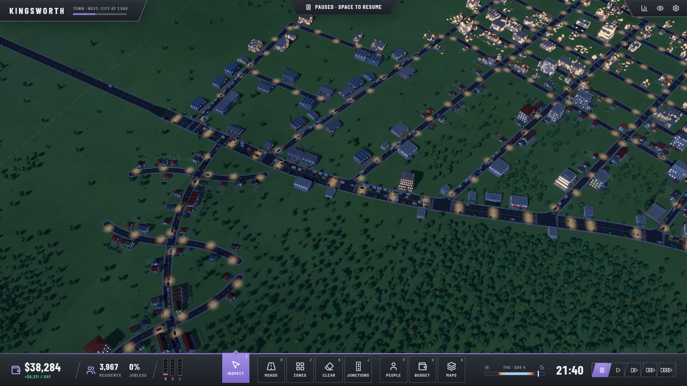
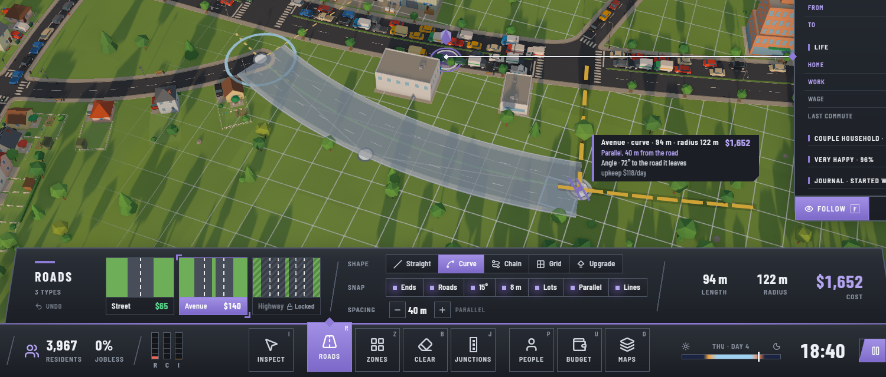
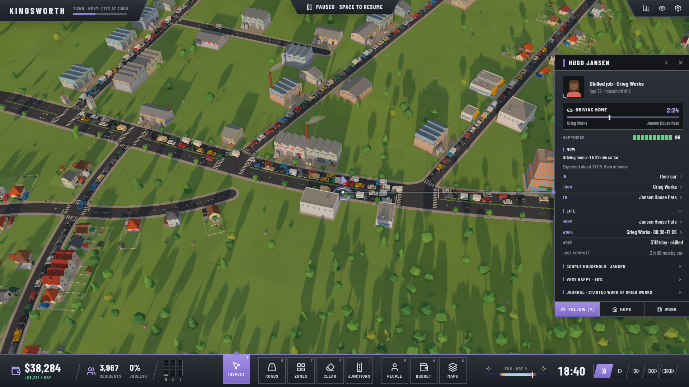
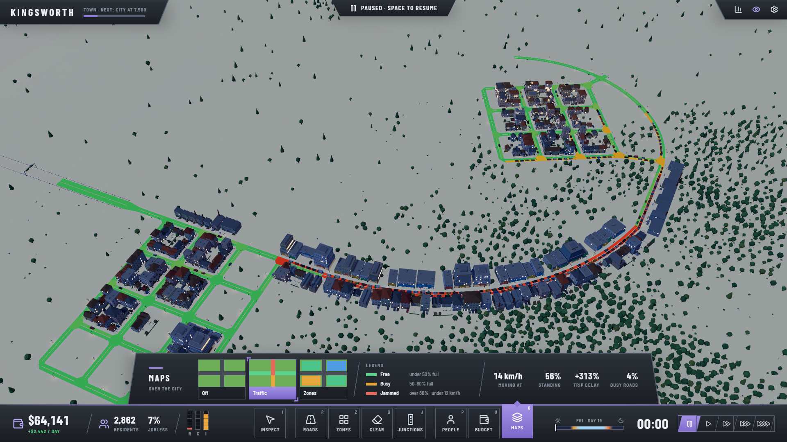

# CitySim

A small, original 3D city-builder written in Rust with [Bevy](https://bevy.org) 0.20. Start on an empty map with a
highway stub, draw straight and curved roads, zone homes, shops and industry along them, and watch a town grow. Every
resident is a person with a home, a household, a job or school, a daily routine and a mood; every car on the road is
somebody going somewhere. A bad road layout shows up as real traffic jams that make people late, cost businesses
working hours and empty out the city's purse.




## Features

- **Free-form roads**: straight roads, curves (start, corner, end), continuous chains of curves, and whole street
  grids at any angle. Snapping to road ends and junctions, onto a road for a T, straight on and at right angles from
  the road you start on, 15° steps, whole 8 m lengths, the zoning lattice next door, a parallel road at a set
  distance, extensions and the points where two guides meet; each rule can be switched off (Alt holds them all off).
  A card at the cursor shows length, bend, price and upkeep, and a refusal is drawn in red where it happens, with the
  reason. Streets and avenues (two lanes each way); the upgrade tool turns a stretch into the other kind. Undo.
- **Zoning** in blocks along each side of each road, on lattices that follow the road's angle: paint, along a road
  (one or two rows), fill a block, or a rectangle. Buildings grow by demand on 1x1, deep 1x2 and 2x2 lots, always
  facing their road, and level up from houses, small shops and sheds to apartment blocks, offices and works.
- **Traffic** in real time: cars drive on the right in lanes, choose lanes before turns and wait at junctions with
  real rules — actuated traffic lights with protected left turns, priority junctions where side streets give way, and
  all-way stops. Junctions pick their control by road type and traffic; the junction tool shows each approach's
  light and queue and lets you choose. The traffic map shows how full each direction is, how fast cars move, how many
  are standing and how much longer trips take than on empty roads.
- **People**: click a home, a workplace or a car to see who lives, works or rides there; click a person for what
  they are doing now and next, their trip (and how late they are), household, work, money, happiness and its reasons,
  and a journal. Follow anyone with the camera. The People drawer shows the whole city: ages, households, work, what
  everyone is doing right now, trips today and why people are unhappy.
- **Money**: taxes per zone (businesses pay on the hours their staff actually work, so jams cost money), road upkeep
  by kind, traffic lights, and city services that cost more per resident as the city grows and densifies. The budget
  drawer shows yesterday, today so far, where the running costs go, a two-week chart and the tax rate. Debt cuts city
  services; demand falls and people leave until the budget is fixed, and the drawer says what would fix it.
- **Day and night** on a 16-minute day: the sun and moon cross the sky, street lamps, windows, headlights and brake
  lights come on at dusk, rush hours fill the roads.
- **A game HUD docked to the screen edges**: money, residents, jobless and demand on the left of the bottom bar, the
  tools in the middle, the clock and five-step speed switch on the right; a drawer that rises from the bar for the
  active tool, the budget, people, maps and statistics; a selection panel on the right edge with foldable sections;
  the city plate and alerts along the top. Settings (graphics quality, interface size, edge scrolling, lot markers)
  are remembered. Designed at 1920x1080, compact down to 1280x720, sharp at 2560x1440.
- Pause and four speeds (1x, 3x, 6x, 12x: a day in 16 minutes down to 80 seconds), one save slot.

Out of scope for this version: terrain height, water, transit, pedestrians on screen, utilities, land value,
pollution and audio.

## Build and run

Needs a recent stable Rust toolchain (edition 2024). On Linux, Bevy needs the usual system packages
(`libasound2-dev libudev-dev libxkbcommon-x11-0` or your distribution's equivalents) and a Vulkan- or GL-capable driver
(software rendering works, slowly).

```sh
cargo run -p citysim --release      # play (the first build takes about 10 minutes)
cargo test --workspace              # simulation and game tests
```

The save slot is `~/.local/share/citysim/city.citysave` on Linux (`~/Library/Application Support/CitySim` on macOS,
`%APPDATA%\CitySim` on Windows); `CITYSIM_SAVE_DIR` overrides it. Saves from the first versions still load. Settings are
kept in `~/.config/citysim/settings.cfg` (the same folders on macOS and Windows; `CITYSIM_CONFIG_DIR` overrides it).







## Controls

| Input | Action |
|---|---|
| Left click / drag | Use the current tool. Roads: click points (or drag a straight piece); Enter or a double-click builds the whole road. Zones and the bulldozer: click, drag or paint, by the mode chosen in the drawer or with Tab |
| Right click, Esc | Step back (the piece in progress, then the whole road); again: back to Inspect, then the pause menu |
| I | Inspect: point at buildings, roads and cars; click one to show it in the side panel |
| R | Roads (again: street / avenue) · J junctions: lights or priority |
| Z | Zones (again: homes / shops / industry / de-zone) · B clear (bulldoze) |
| Tab | Next mode of the tool (roads: straight, curve, chain, grid, upgrade; zones: paint, along a road, fill, rectangle) |
| Alt · Backspace · [ ] | Hold to place without snapping · remove the last point · grid block size |
| Ctrl+Z | Undo the last road, zoning or demolition (no refund for demolitions) |
| P · U · O · T | The city's people · budget · maps (cycles zones and traffic) · traffic map |
| F | Follow the person or car in the side panel (a pan key or Esc lets go) |
| F6 | Move the keyboard into the open drawer: arrow keys choose, Enter presses, Esc leaves |
| Space · 1 2 3 4 | Pause · speed 1x / 3x / 6x / 12x |
| WASD or arrows · Q / E | Pan · rotate (Shift pans faster); edge scrolling can be switched on in Settings |
| Mouse wheel · middle drag | Zoom · rotate and tilt |
| G | Graphics quality (Low / Medium / High) |
| F5 · F9 | Save · load |

## Project layout

- `crates/sim` — the simulation: all state and rules, pure Rust (no Bevy), deterministic, driven by `Command`s and a
  fixed-step `World::step()`.
- `crates/game` — the Bevy front-end: `gfx/` (3D drawing and camera), `ui/` (interface, tools, input, save/load),
  `shared.rs` (the only contract between the two), `dev/` (development scenarios, screenshots, scripted play).
- `scripts/play.py` — scripted play-through driving the real game with OS input (development).

See `CLAUDE.md` for developer notes and dev flags, and `THIRD_PARTY_NOTICES.md` for bundled font licences.

## Development shortcuts

```sh
CITYSIM_DEMO=organic cargo run -p citysim --release # a ~3,900-resident town of curves, a ring and cul-de-sacs
CITYSIM_DEMO=city cargo run -p citysim --release    # start in a ~5,000-resident town (also: town, jam, shapes)
CITYSIM_DEMO=hierarchy cargo run -p citysim --release   # ~10,000 residents, avenues and streets (about 50 s to build)
CITYSIM_DEMO=town CITYSIM_AUTOSHOT=/tmp/t.png cargo run -p citysim --release   # screenshot and exit
cargo run -p citysim_sim --release --example headless   # balance runs of scripted cities, no window
```

CI (`.github/workflows/ci.yml`) checks formatting, clippy and the simulation tests (including the pinned determinism
checksum), and builds and tests the game crate in all three feature sets.

Performance (GTX 1080, 1920x1080, windowless benchmark `CITYSIM_BENCH`, a ~10,000-resident city with about 850 cars on
the road): about 110 fps on High (99th-percentile frame 11 ms) and 220 fps on Low at 1x, and still above 100 fps on
High at 12x.
